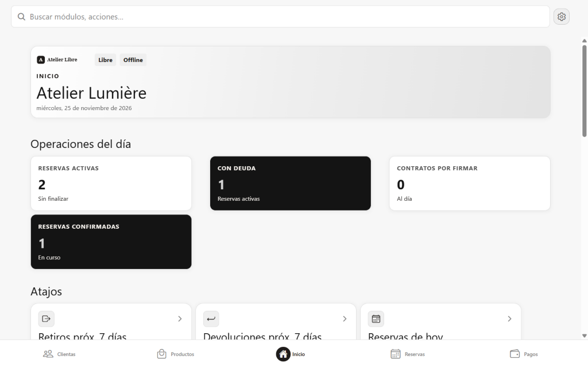
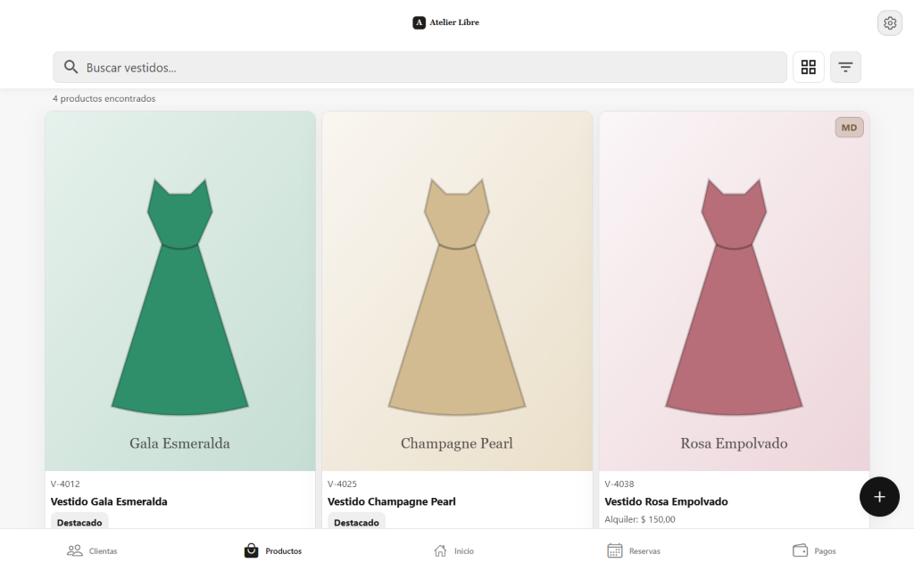
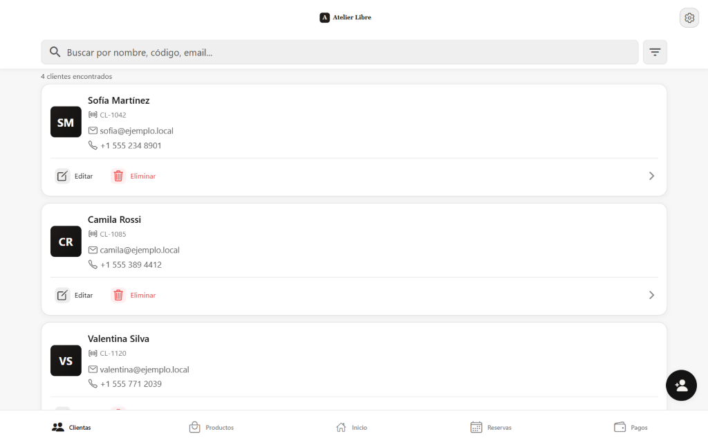
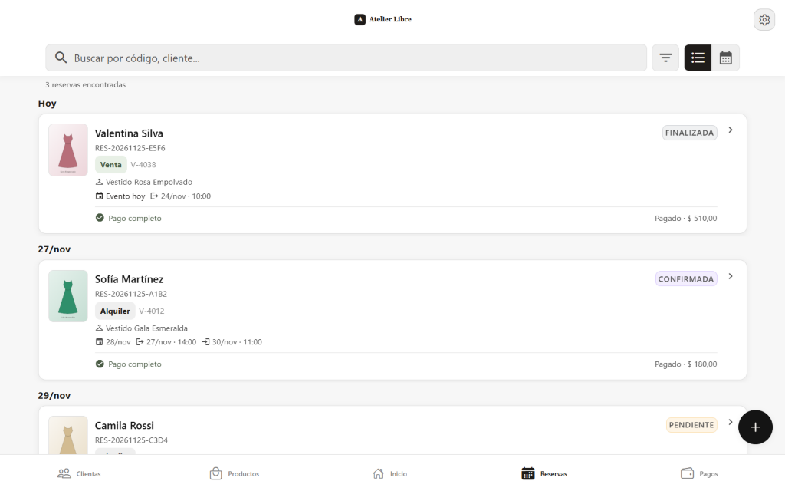
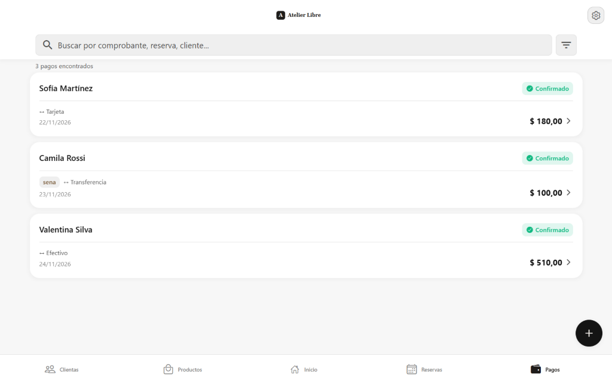
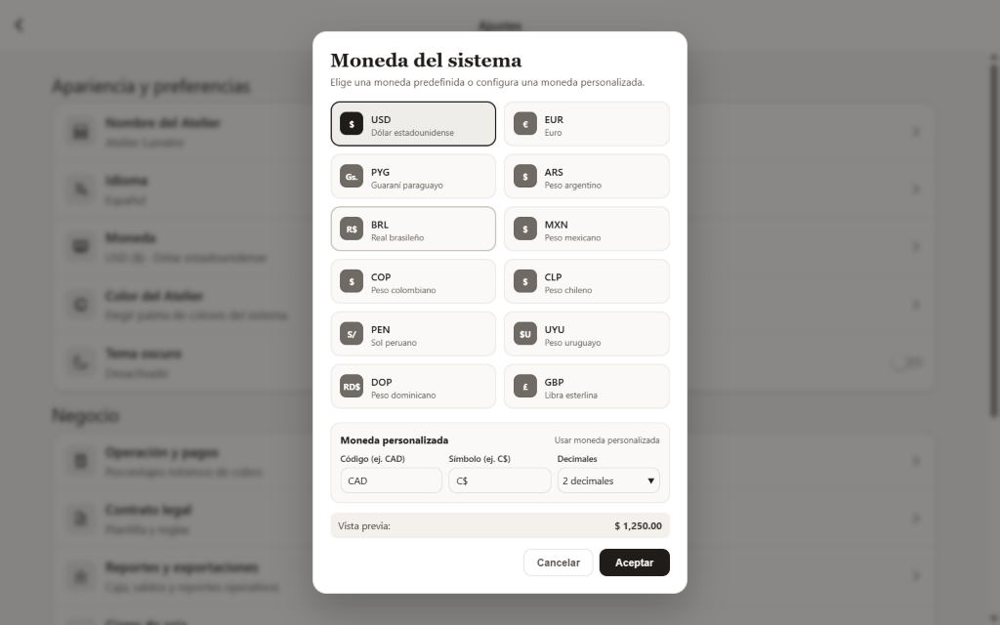
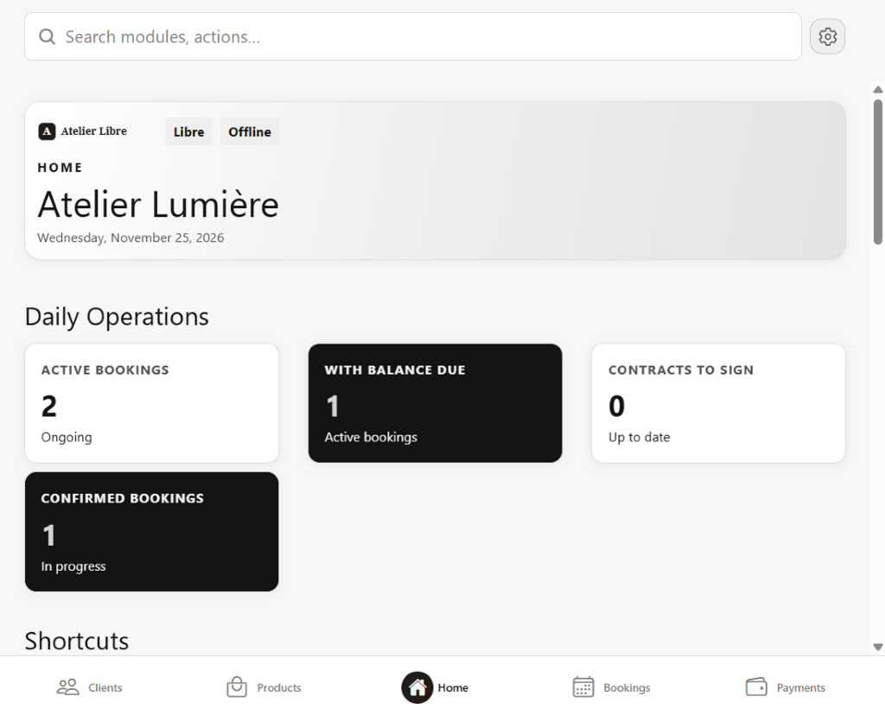

# Atelier Libre

Sistema de gestión de atelier, boutique de vestidos y alquiler/venta de prendas — **100 % offline, gratuito, sin licencia, sin cuentas y listo para usar en Windows**.

*An offline, free, no-license Windows desktop application for managing dress ateliers, boutiques, rentals, sales, clients, bookings, and payments.*

---

## Descarga directa (Sin compilar) / Direct Download (Ready to Run)

No necesitas instalar herramientas ni compilar nada. Descarga el ejecutable y ábrelo directamente en Windows 10 / 11:

- **[Descargar AtelierLibre.exe](https://github.com/Memorysinc/atelier-libre/raw/main/AtelierLibre.exe)** *(Windows x64 — ejecutable único autocontenido)*

> Tus datos se guardan automáticamente de forma local en `%LocalAppData%\AtelierLibre\` (nunca se envían a servidores externos).

*No compilation or setup required. Just download `AtelierLibre.exe` and double-click to run on Windows 10/11. All data is stored locally on your PC.*

---

## Características / Features

- **100 % Offline y autónomo:** Sin servidores externos, sin cuentas, sin activaciones ni claves de licencia.
- **Varios idiomas / Multi-language:** Español, English, Português y Français (cambio instantáneo desde **Ajustes → Idioma**).
- **Varias monedas / Multi-currency:** 12 monedas predefinidas (`USD`, `EUR`, `PYG`, `ARS`, `BRL`, `MXN`, `COP`, `CLP`, `PEN`, `UYU`, `DOP`, `GBP`) más soporte para **moneda personalizada** (código, símbolo y decimales).
- **Gestión completa:**
  - **Catálogo de productos:** Fotos, precios de alquiler/venta/garantía, colores, estilos, talles, largos, ubicación operativa (en tienda, modista, lavandería).
  - **Clientas:** Ficha completa, historial de reservas, pagos y registro de medidas corporales.
  - **Reservas y agenda:** Alquileres, ventas, citas, fechas de retiro/evento/devolución, cargos adicionales y estados.
  - **Pagos y caja:** Registro de cobros (efectivo, transferencia, tarjeta), saldos pendientes, cierre de caja y exportación de reportes en CSV.
  - **Contratos:** Plantilla editable e impresión local.
- **Personalización y respaldo:** Nombre del atelier editable, **tema Neutro Carbón (blanco y negro) por defecto**, 7 paletas de color (`Neutro Carbón`, `Océano Azul`, `Verde Esmeralda`, `Rosa Palo`, `Azul Índigo`, `Arena Suave`, `Dorado Atelier`), modo claro/oscuro y exportación/importación completa en JSON.

---

## Capturas de pantalla / Screenshots

### Inicio / Dashboard (Español)

### Catálogo de productos / Catalog

### Clientas / Clients

### Reservas / Bookings

### Pagos / Payments

### Ajustes / Settings

### Selector de moneda y moneda personalizada / Multi-currency

### Interfaz en inglés + USD / English UI + USD

### Paletas de colores (7 temas + modo oscuro) / Color Themes

