

  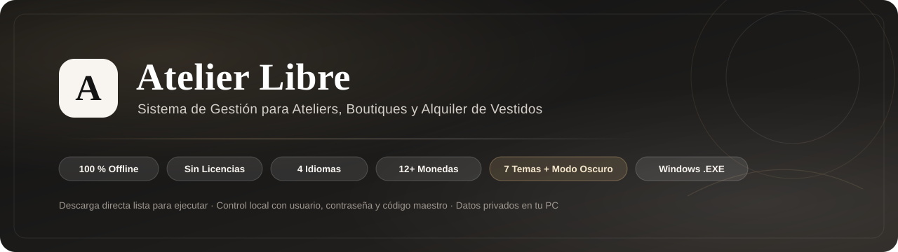

  <strong>Tu atelier, tus datos, tus reglas.</strong> 
  Gestión integral de vestidos, clientas, reservas, cobros y contratos para Windows — <strong>100 % offline, gratuito, sin licencias ni suscripciones.</strong>

  
  
  
  
  
  

  

---

## Arranque en 30 segundos (Sin compilar nada)

No necesitas Node.js, Python, .NET ni conocimientos técnicos:

1. **Descarga** [**`AtelierLibre.exe`**](https://github.com/Memorysinc/atelier-libre/raw/main/AtelierLibre.exe) *(ejecutable único autocontenido)*.
2. **Haz doble clic** para abrir la aplicación directamente en Windows 10 u 11.
3. **Configura tu atelier** en el asistente inicial: elige el nombre comercial, idioma y crea tu usuario y contraseña locales.

> **Privacidad real:** Todos tus registros, fotos, clientes, pagos y preferencias viven únicamente en tu equipo (`%LocalAppData%\AtelierLibre\`). Cero nube, cero telemetría y cero dependencias externas.

---

## ¿Por qué elegir Atelier Libre?

<table>
  <tr>
    <td width="50%" valign="top">
      <h3>🔒 Acceso local y recuperación segura</h3>
      <ul>
        <li>Configuración inicial guiada con usuario y contraseña locales (PBKDF2).</li>
        <li>Cambio de credenciales en cualquier momento desde <strong>Ajustes → Seguridad y sesión</strong>.</li>
        <li>Recuperación de acceso mediante <strong>Código Maestro</strong> sin perder tus datos.</li>
        <li>Bloqueo de sesión en 1 clic y comando de restauración de fábrica (<code>Shift + 1147</code>).</li>
      </ul>
    </td>
    <td width="50%" valign="top">
      <h3>🌍 Multi-idioma y Multi-moneda reales</h3>
      <ul>
        <li><strong>4 idiomas completos:</strong> Español, English, Português y Français (cambio inmediato desde la pantalla de inicio o Ajustes).</li>
        <li><strong>12 monedas predefinidas:</strong> <code>USD</code>, <code>EUR</code>, <code>PYG</code>, <code>ARS</code>, <code>BRL</code>, <code>MXN</code>, <code>COP</code>, <code>CLP</code>, <code>PEN</code>, <code>UYU</code>, <code>DOP</code> y <code>GBP</code>.</li>
        <li><strong>Moneda personalizada:</strong> define cualquier código, símbolo y decimales (<code>0</code> o <code>2</code>) con vista previa en vivo.</li>
      </ul>
    </td>
  </tr>
  <tr>
    <td width="50%" valign="top">
      <h3>👗 Flujo completo de Atelier</h3>
      <ul>
        <li><strong>Catálogo:</strong> fotografías, precios de alquiler/venta/garantía, colores, estilos, talles, largos y control de ubicación (<em>En tienda</em>, <em>Modista</em>, <em>Lavandería</em>).</li>
        <li><strong>Clientas:</strong> ficha completa, historial financiero y registro detallado de medidas corporales.</li>
        <li><strong>Reservas:</strong> alquileres, ventas, citas, retiros/devoluciones y cargos adicionales.</li>
      </ul>
    </td>
    <td width="50%" valign="top">
      <h3>💳 Caja, Contratos y Respaldos</h3>
      <ul>
        <li><strong>Pagos y arqueo:</strong> cobros en efectivo, transferencia o tarjeta, cálculo de saldos y cierre de caja diario.</li>
        <li><strong>Reportes CSV y contratos:</strong> exportación local en CSV y plantilla de contrato imprimible.</li>
        <li><strong>Respaldo portátil:</strong> exporta e importa toda tu base de datos en un único archivo <code>.json</code>.</li>
      </ul>
    </td>
  </tr>
</table>

---

## Galería de Temas — 7 Paletas + Modo Oscuro

Por defecto arranca en el estilo minimalista **Neutro Carbón (blanco y negro)**, y desde **Ajustes → Color del Atelier** puedes cambiar entre **7 paletas editoriales** más **Modo Oscuro**:

<table>
  <tr>
    <td align="center" width="50%">
      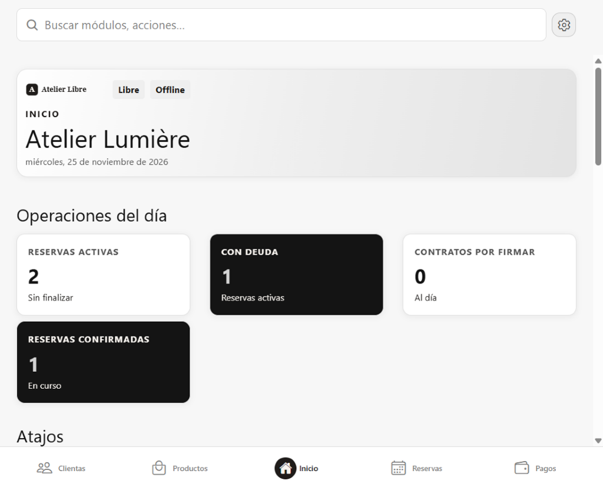 
      <strong>1. Neutro Carbón (Por defecto — Blanco y Negro)</strong>
    </td>
    <td align="center" width="50%">
      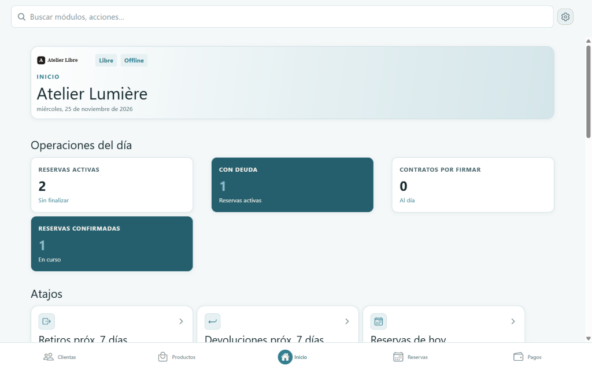 
      <strong>2. Océano Azul</strong>
    </td>
  </tr>
  <tr>
    <td align="center" width="50%">
      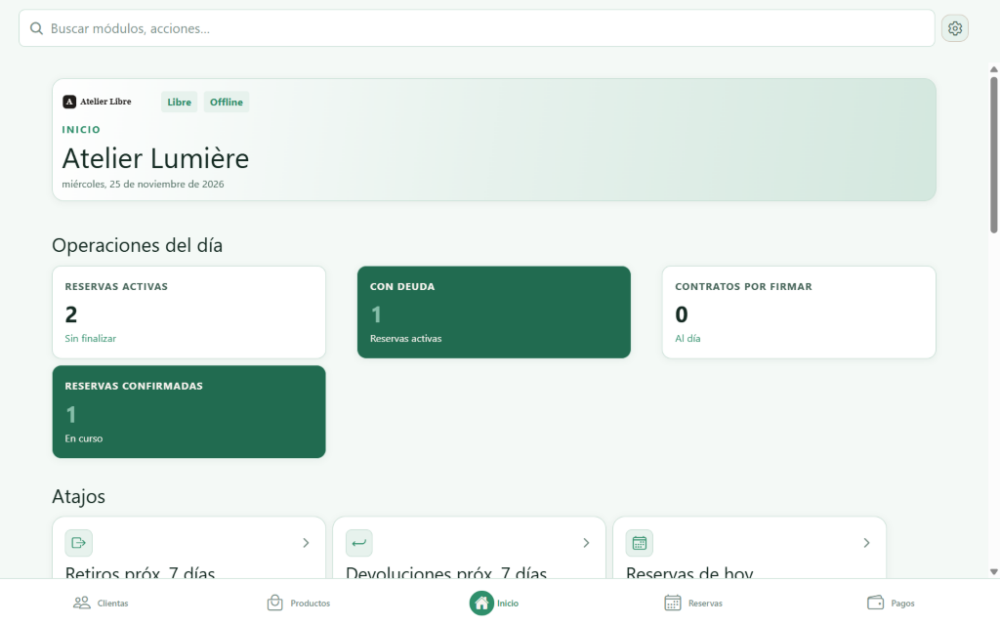 
      <strong>3. Verde Esmeralda</strong>
    </td>
    <td align="center" width="50%">
      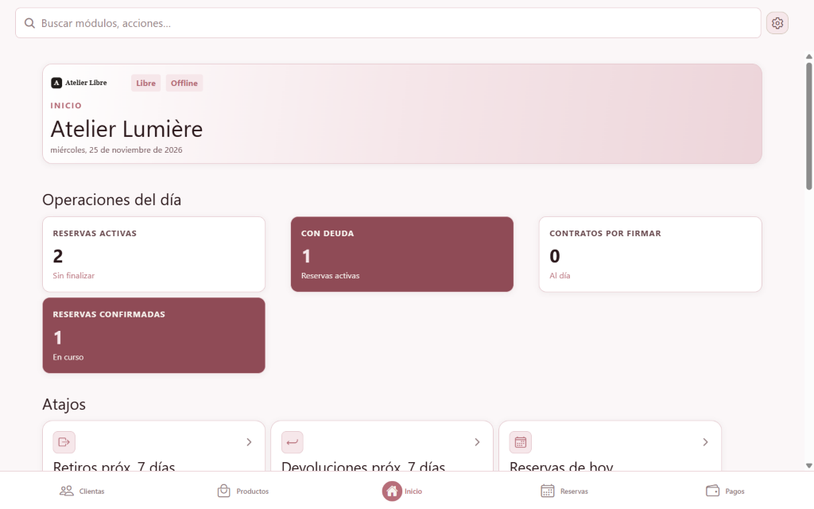 
      <strong>4. Rosa Palo</strong>
    </td>
  </tr>
  <tr>
    <td align="center" width="50%">
      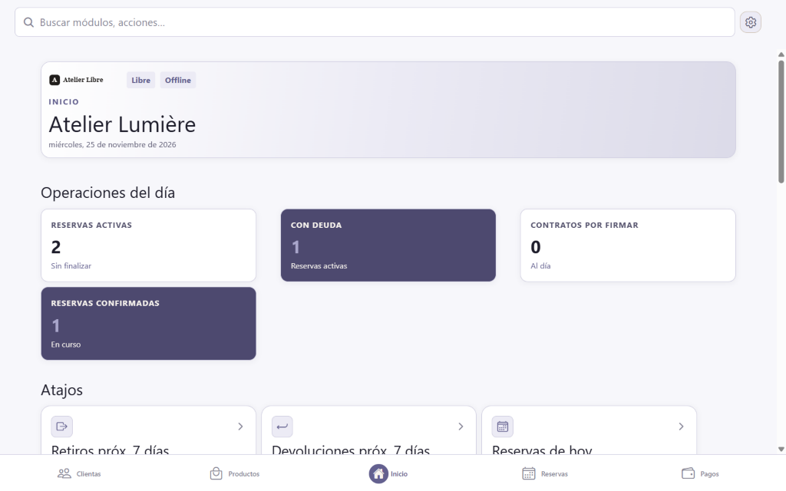 
      <strong>5. Azul Índigo</strong>
    </td>
    <td align="center" width="50%">
      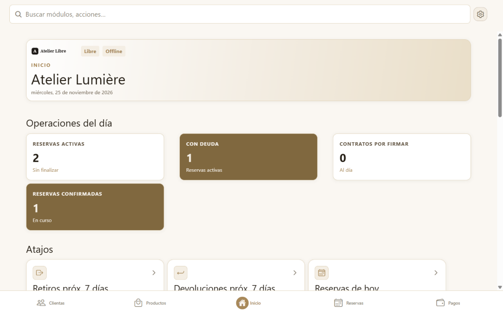 
      <strong>6. Arena Suave</strong>
    </td>
  </tr>
  <tr>
    <td align="center" width="50%">
      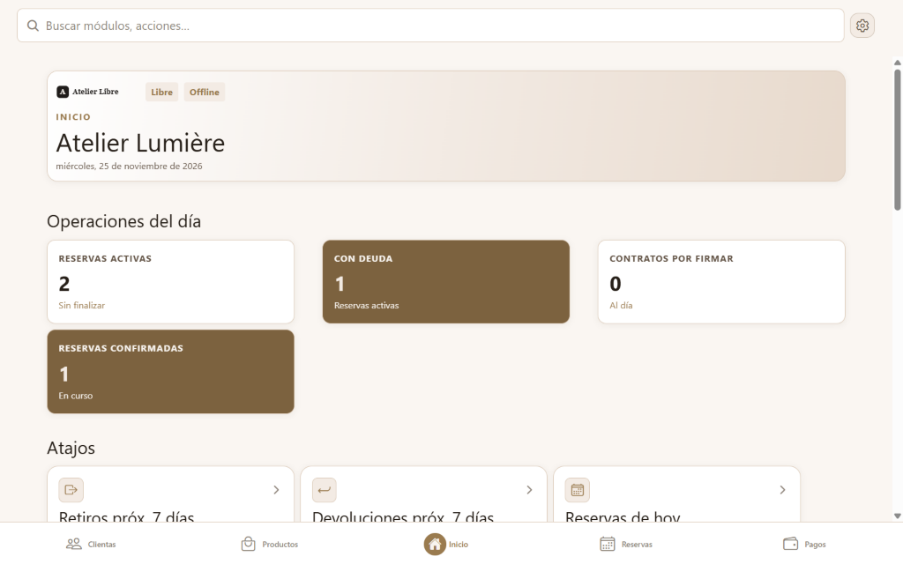 
      <strong>7. Dorado Atelier</strong>
    </td>
    <td align="center" width="50%">
      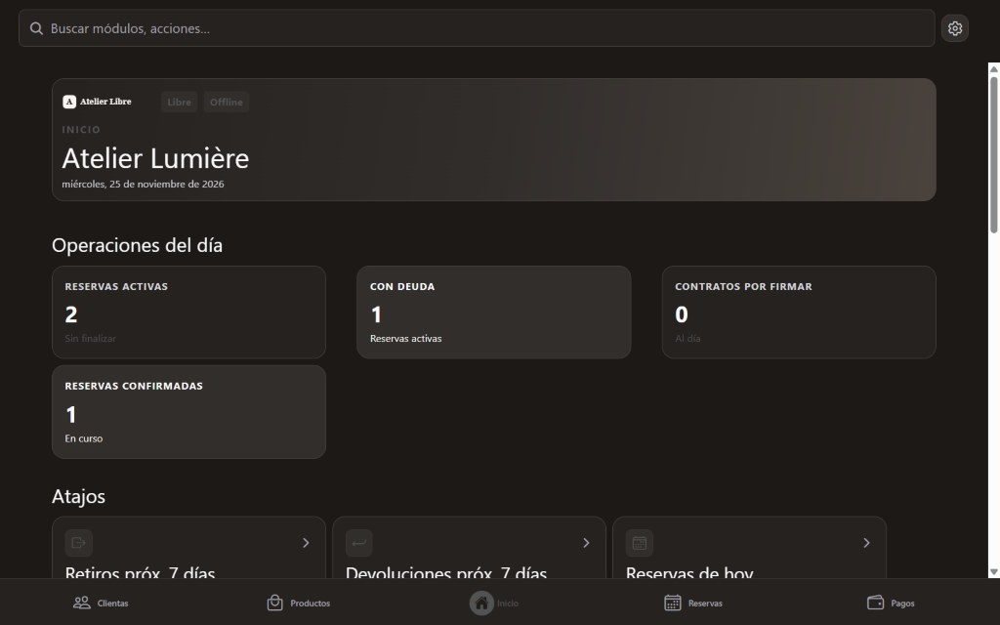 
      <strong>8. Modo Oscuro</strong>
    </td>
  </tr>
</table>

---

## Recorrido por la Aplicación

### Acceso local y Configuración inicial
<table>
  <tr>
    <td align="center" width="50%">
      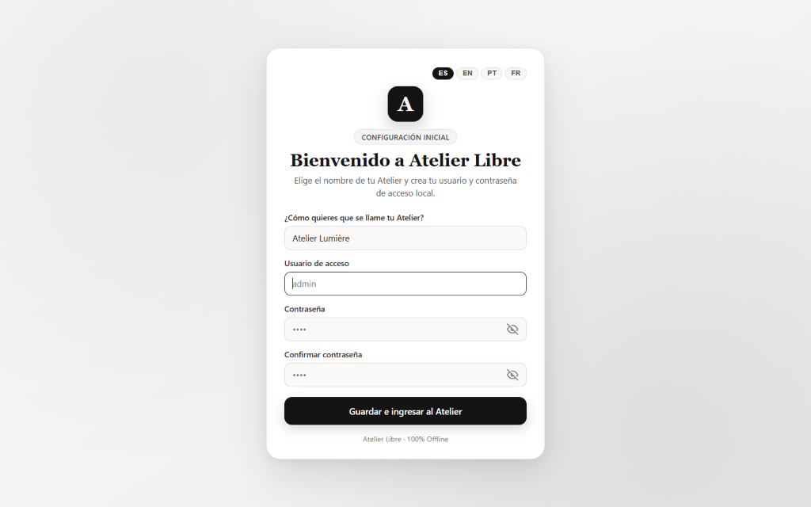 
      <strong>Configuración inicial:</strong> nombre comercial, idioma y credenciales locales (sin activación ni licencias).
    </td>
    <td align="center" width="50%">
      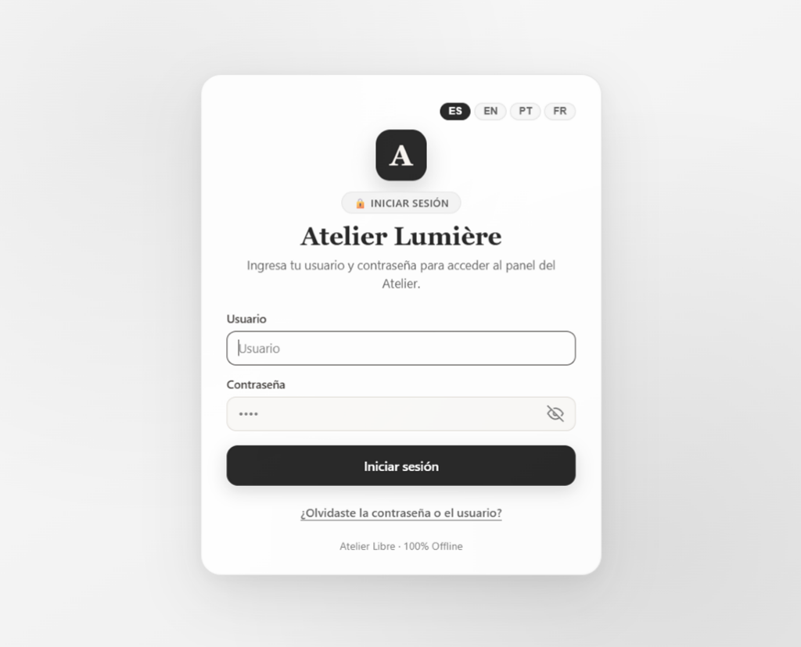 
      <strong>Inicio de sesión:</strong> acceso protegido por usuario/contraseña y recuperación con Código Maestro.
    </td>
  </tr>
</table>

### Módulos principales
<table>
  <tr>
    <td align="center" width="50%">
       
      <strong>Catálogo:</strong> inventario visual con filtros avanzados, etiquetas y precios dinámicos.
    </td>
    <td align="center" width="50%">
       
      <strong>Clientas:</strong> fichas de contacto, historial y toma de medidas.
    </td>
  </tr>
  <tr>
    <td align="center" width="50%">
       
      <strong>Reservas:</strong> seguimiento de alquileres, ventas, fechas de retiro/devolución y saldos.
    </td>
    <td align="center" width="50%">
       
      <strong>Pagos:</strong> historial de cobros confirmados, métodos de pago y comprobantes.
    </td>
  </tr>
</table>

### Personalización, Multi-moneda y Multi-idioma
<table>
  <tr>
    <td align="center" width="50%">
      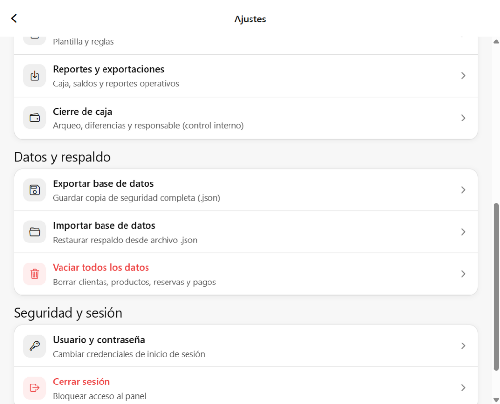 
      <strong>Ajustes:</strong> idioma, moneda, colores, modo oscuro, negocio, respaldos JSON y seguridad.
    </td>
    <td align="center" width="50%">
      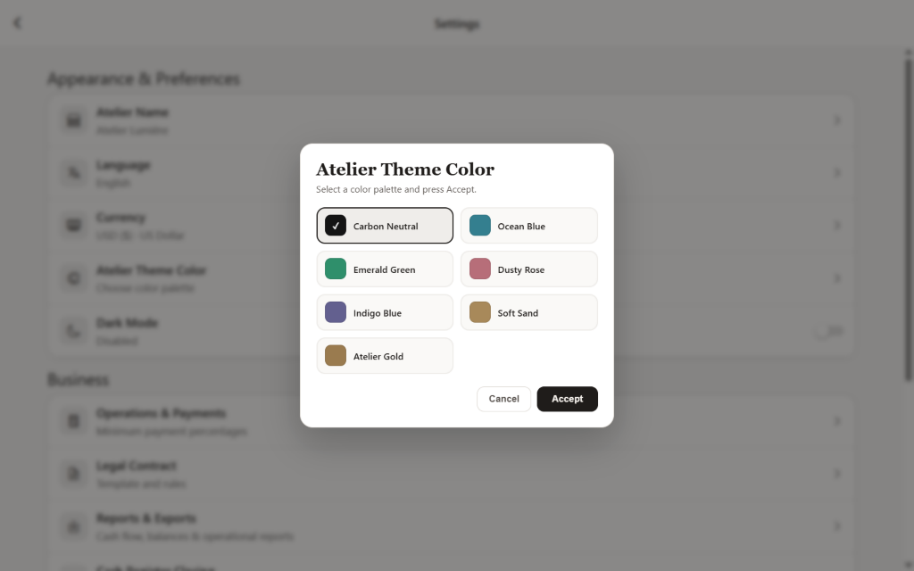 
      <strong>Selector visual de temas:</strong> cambia al instante entre las 7 paletas disponibles.
    </td>
  </tr>
  <tr>
    <td align="center" width="50%">
       
      <strong>Selector de moneda:</strong> 12 monedas listas para usar o configura tu propia moneda con vista previa.
    </td>
    <td align="center" width="50%">
       
      <strong>Interfaz multi-idioma:</strong> ejemplo completo en English + USD ($).
    </td>
  </tr>
</table>

---

## Idiomas y Monedas Compatibles

| Idiomas | Monedas Predefinidas | Moneda Personalizada |
| :--- | :--- | :--- |
| 🇪🇸 **Español** (`es`) | `USD` (`$`), `EUR` (`€`), `GBP` (`£`) | Código libre (ej. `CAD`, `CHF`) |
| 🇺🇸 **English** (`en`) | `PYG` (`Gs.`), `ARS` (`$`), `BRL` (`R$`) | Símbolo libre (ej. `C$`, `Fr.`) |
| 🇧🇷 **Português** (`pt`) | `MXN` (`$`), `COP` (`$`), `CLP` (`$`) | Decimales configurables (`0` o `2`) |
| 🇫🇷 **Français** (`fr`) | `PEN` (`S/`), `UYU` (`$U`), `DOP` (`RD$`) | Formato numérico automático |

---

<strong>Preguntas frecuentes / FAQ</strong>

- **¿Dónde se guardan mis datos?**  
  Todo se almacena localmente en `%LocalAppData%\AtelierLibre\` (`db.json`, `prefs.json` y `auth.json`).
- **¿Cómo hago una copia de seguridad o traslado mis datos a otra PC?**  
  Ve a **Ajustes → Datos y respaldo → Exportar base de datos** para descargar un archivo `.json`. En la otra PC, usa **Importar base de datos**.
- **¿Cómo cambio mi usuario o contraseña?**  
  Ve a **Ajustes → Seguridad y sesión → Usuario y contraseña**.
- **¿Qué hace `Shift + 1147`?**  
  Abre el diálogo de **Restauración de Fábrica** para limpiar usuario, preferencias y base de datos local si deseas empezar completamente desde cero.
- **¿Requiere conexión a internet o cuenta en la nube?**  
  No. Funciona 100 % offline desde el primer segundo.

---

### English Summary

**Atelier Libre** is a free, zero-license, 100% offline Windows desktop app for dress boutiques, bridal shops, and fashion ateliers. Download [**`AtelierLibre.exe`**](https://github.com/Memorysinc/atelier-libre/raw/main/AtelierLibre.exe) and double-click to run — no compiler or dependencies required. Features local account setup & password lock with Master Recovery Code, 4 languages (`ES`, `EN`, `PT`, `FR`), 12 preset currencies + custom currency, 7 color themes (black-and-white Carbon by default) + Dark Mode, catalog/clients/bookings/payments management, contracts, CSV reports, and portable JSON backups.
